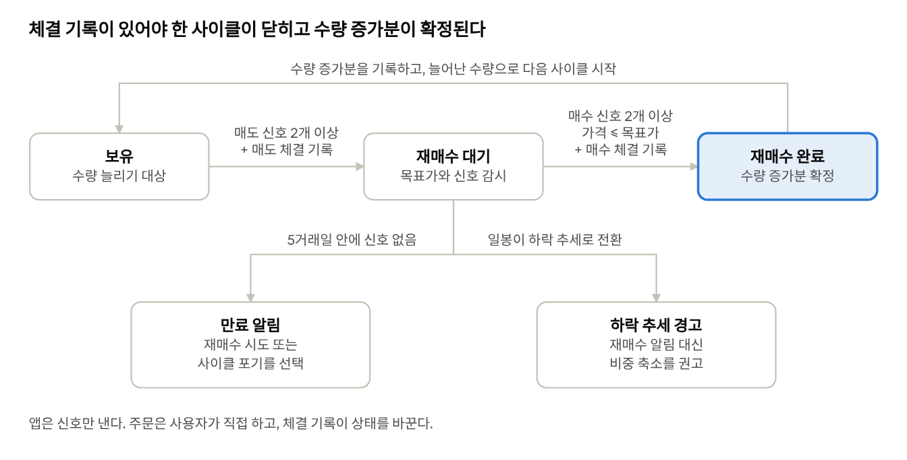
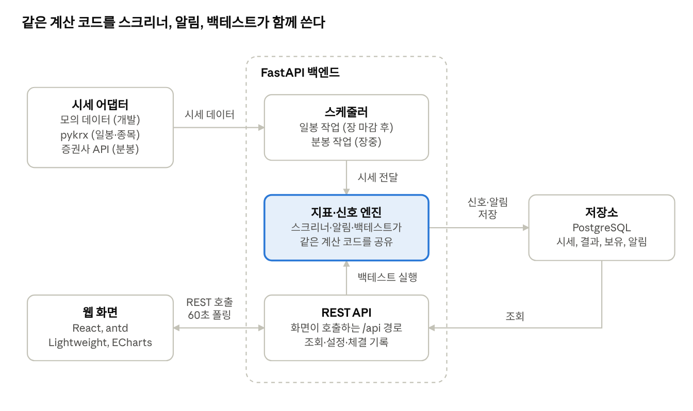
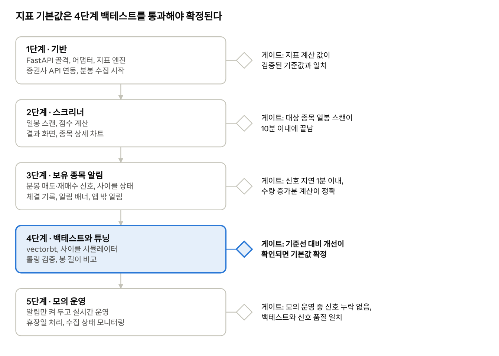

# KOSPI 턴어라운드 알림 웹앱 — 기획안 및 PRD

Oct 13, 2026 · @정수

## 1. 기획 배경과 문제 정의

KOSPI 시가총액 상위 100개와 KOSDAQ 시가총액 상위 20개 종목 중 바닥을 다지고 반등하는 턴어라운드 후보를 매일 자동으로 추리고, 보유 종목은 분봉(기본 60분봉) 기준으로 팔 때와 다시 살 때를 알려 주어 보유 수량을 늘리도록 돕는 알림 전용 웹앱이다.

- **차트 확인 부담**: 전 종목 차트를 눈으로 훑는 데 시간이 오래 걸리고, 판단 기준도 그때그때 달라진다.
- **단일 지표의 한계**: 거래량 3배 증가나 1분봉 MACD 골든크로스 하나만으로는 가짜 신호가 많다. 바닥 조건, 반전 신호, 확인 신호, 안전 필터를 묶어 점수로 판단해야 한다.
- **수량 늘리기의 함정**: 팔고 나서 더 비싸게 다시 사면 수량이 오히려 줄어든다. 수수료와 거래세를 반영해 "판 가격보다 충분히 낮게 다시 산다"는 조건이 있어야 한다.

**범위 결정**: 스캔 대상은 KOSPI 시가총액 상위 100개와 KOSDAQ 시가총액 상위 20개 종목, 기능은 알림까지만(자동 주문 없음), 형태는 웹앱이다. 프런트엔드는 React, 화면 구성은 wewatch 2.0을 참고한 Ant Design(antd), 차트는 가격 차트에 Lightweight Charts, 그 밖의 차트에 ECharts를 쓴다.

## 2. 목표와 범위

1차 목표는 장 마감 후 KOSPI 상위 100개와 KOSDAQ 상위 20개 종목(시가총액 기준)에서 턴어라운드 후보를 자동으로 추리고, 보유 종목에는 장중 분봉(기본 60분봉) 매도·재매수 신호를 알림으로 주는 것이다.

**목표**

- 매 거래일 장 마감 후 KOSPI 상위 100개와 KOSDAQ 상위 20개 종목을 일봉으로 스캔해 점수 상위 후보를 보여 준다.
- 보유 종목마다 분봉 신호를 장중에 갱신하고, 새 신호가 뜨면 알림을 띄운다.
- 모든 신호에 근거가 된 지표 값을 함께 보여 줘서 왜 떴는지 바로 확인할 수 있다.
- 조건과 파라미터를 화면에서 바꾸고, 같은 조건을 과거 데이터로 백테스트할 수 있다.

**성공 지표 (초안, 백테스트로 기준선을 잡은 뒤 확정)**

| 지표 | 목표 | 측정 방법 |
| --- | --- | --- |
| 일봉 대상 종목 스캔 시간 | 장 마감 후 10분 이내 | 스캔 작업 로그 |
| 분봉 신호 알림 지연 | 봉 마감 후 1분 이내 | 봉 마감 시각과 알림 생성 시각의 차 |
| 후보 종목 적중률 | 백테스트 기준선 대비 개선 | 후보 선정 후 5거래일 수익률 분포 |
| 재매수 완료 건의 수량 증가율 | 수수료·세금 반영 후 0% 초과 | 매도·재매수 쌍별 수량 비교 |

**비목표 (1차 범위 밖)**

- 자동 주문과 자동매매. 신호는 알림까지만 제공한다.
- 해외 주식, 그리고 시가총액 순위 밖 종목의 스크리닝.
- 1분봉 신호를 단독 매수·매도 조건으로 쓰는 것.
- 종목 추천이나 투자 자문. 화면의 모든 신호는 지표 기반 참고 정보다.

## 3. 사용자와 핵심 시나리오

주 사용자는 국내 주식(KOSPI·KOSDAQ)을 직접 보유하며, 장중 내내 차트를 볼 수 없어 신호를 알림으로 받고 싶은 개인 투자자 한 명이다. 계정은 단일 사용자(standalone)로 시작한다.

| 시나리오 | 흐름 | 결과 |
| --- | --- | --- |
| 장 마감 후 후보 확인 | 스크리너에서 점수 상위 종목을 보고, 종목을 눌러 일봉 차트와 충족 조건을 확인한다. | 관심종목에 추가하거나 제외한다. |
| 장중 매도 신호 | 보유 종목에 분봉 매도 신호가 뜨면 알림 배너와 앱 밖 알림이 나오고, 제안 수량과 재매수 목표가가 함께 보인다. | 사용자가 증권사 앱에서 직접 매도하고, 앱에는 체결을 기록한다. |
| 재매수 신호 | 재매수 목표가 이하에서 반등 신호가 겹치면 알림이 나온다. | 사용자가 직접 매수하고 체결을 기록하면 수량 증가분이 계산된다. |
| 조건 조정과 검증 | 지표 파라미터를 바꾸고 과거 데이터로 백테스트한다. | 결과가 마음에 들면 프리셋으로 저장한다. |

앱은 주문하지 않으므로, 매도 후 재매수 대기 상태를 이어 가려면 사용자의 체결 기록이 필요하다. 이 기록 입력은 두 번의 클릭 안에 끝나도록 설계한다.

## 4. 기능 1: 턴어라운드 종목 스크리너

스크리너는 안전 필터와 바닥 조건을 통과한 종목에만 반전·확인·거래량·수급 점수를 매기고, 합산 점수 순으로 후보를 보여 준다. 신호 하나로 거르면 가짜 신호가 많아, 단계별 점수로 신뢰도를 쌓는 방식을 택했다. 지표별 기본값은 6장에 있다.

| ID | 요구사항 | 우선순위 |
| --- | --- | --- |
| S-1 | 스캔 대상은 스캔 일자 기준 KOSPI 시가총액 상위 100개와 KOSDAQ 시가총액 상위 20개 종목이다. 이 중 관리종목, 거래정지, 투자경고·위험 종목, 거래대금 하한 미달 종목은 점수와 관계없이 제외한다. | P0 |
| S-2 | 바닥 조건을 필수 게이트로 둔다. 52주 고점 대비 낙폭 조건을 충족하고, 20일선 이격도 조건 또는 볼린저 하단 이탈 이력 조건 중 하나 이상을 충족한 종목만 통과한다. 대형주 120종목에는 해당하는 종목이 적을 수 있어, 후보가 너무 적으면 낙폭 기준을 완화하거나 하락률 순위 방식으로 바꿀 수 있게 한다. | P0 |
| S-3 | 반전 신호를 점수화한다. RSI 30 상향 돌파, 주가 저점은 낮아지는데 RSI·MACD 저점은 높아지는 강세 다이버전스, 볼린저 하단 이탈 후 밴드 안 복귀를 본다. | P0 |
| S-4 | 확인 신호를 점수화한다. MACD 골든크로스, 종가의 20일선 회복과 5일선의 20일선 상회(두 이동평균 조건은 각각 별도로 점수화), 직전 하락 파동 고점 돌파, OBV 상승 전환을 본다. | P0 |
| S-5 | 거래량은 20일 평균 대비 배수와 양봉 여부로 판단한다. 음봉이면 배수가 높아도 점수를 주지 않는다. 전일 대비 배수는 선택 옵션으로 둔다. | P0 |
| S-6 | 항목별 가중치와 최소 점수 컷을 화면에서 바꿀 수 있고, 합산 점수는 0\~100으로 표시한다. | P1 |
| S-8 | 결과 표에 종목, 점수, 충족 조건 태그, 거래대금, 등락률을 보여 주고, 종목을 누르면 일봉 차트와 지표 패널이 열린다. | P0 |
| S-9 | 스캔 결과를 날짜별로 저장하고, 과거 날짜의 결과를 다시 볼 수 있다. | P1 |
| S-10 | 수급 신호를 점수화한다. 외국인 연속 순매수, 기관 연속 순매수, 외국인·기관 순매수 강도, 순매수 전환을 일봉 기준 투자자별 순매수 금액으로 계산한다. 수급 데이터가 없는 날에는 수급 구간을 제외하고 나머지 점수를 100점 기준으로 환산하며 '수급 미반영' 태그를 붙인다. | P1 |
| S-11 | 관심종목을 관리한다. 스크리너 결과 표와 종목 상세 Drawer에서 종목을 관심종목에 추가하거나 제외하고, 관심종목 보기에서 종목별 최신 점수와 전일 대비 점수 변화를 본다. 관심종목은 스캔 대상 종목에서만 고를 수 있고, 장중 분봉 알림 대상은 아니다. 실제로 보유하게 되면 보유 종목 화면에서 따로 등록한다. | P1 |

## 5. 기능 2: 보유 종목 분봉 매도·재매수 알림

핵심 규칙은 "판 가격보다 비용을 뺀 목표만큼 낮게 다시 사야 수량이 늘어난다"는 것이며, 앱은 이 조건을 만족하는 재매수 목표가를 매도 알림과 함께 계산해 보여 준다. 신호 정의와 기본값은 6장에 있고, 신호 계산에 쓰는 봉 길이는 A-11처럼 설정에서 고른다.

| ID | 요구사항 | 우선순위 |
| --- | --- | --- |
| A-1 | 보유 종목을 등록한다. 종목, 수량, 평균단가를 입력하고, 수량 늘리기 기준점이 되는 시작 수량을 기록한다. | P0 |
| A-2 | 장중 설정한 봉 길이(기본 60분봉)의 봉이 마감될 때마다 보유 종목의 매도 신호를 계산한다. 매도 신호 후보(일봉 수급 이탈 포함) 중 2개 이상이 겹칠 때만 매도 알림을 낸다. A-13의 강제 매도는 이 겹침 조건과 아래 제한에 걸리지 않는다. 사이클당 매도는 1회이며, 재매수 대기 중인 보유 종목에는 재매수가 완료되거나 만료되기 전까지 추가 매도 알림을 내지 않는다. | P0 |
| A-3 | 매도 알림에는 제안 수량을 넣는다. 기본은 보유량의 3분의 1이며, 전량 매도는 제안하지 않는다. 다만 A-13의 강제 매도는 전량을 제안한다. | P0 |
| A-4 | 매도 알림에는 재매수 목표가를 함께 표시한다. 목표가는 직전 매도가에서 왕복 수수료·거래세와 목표 이득을 뺀 값이고, 요율은 설정에서 입력한다. | P0 |
| A-5 | 매도 이후 상태를 재매수 대기로 바꾸고, 가격이 목표가 이하이면서 재매수 신호 후보 중 2개 이상이 겹칠 때 재매수 알림을 낸다. 일봉 수급 이탈 상태이면 알림을 보류하고 경고로 바꾼다. 재매수 알림에는 제안 수량을 넣는다. 제안 수량 = 매도 대금 ÷ 재매수가(수수료 반영)이고, 수량 증가분 = 제안 수량 − 매도 수량이다. | P0 |
| A-6 | 일봉 추세 필터를 둔다. 일봉이 상승 추세일 때만 매도·재매수 사이클을 돌리고, 일봉이 하락 추세로 바뀌면 재매수 알림 대신 비중 축소 경고를 낸다. | P0 |
| A-7 | 재매수 대기에는 시간 제한을 둔다. 기본 5거래일 안에 신호가 없으면 만료 알림을 내고, 재매수 시도 또는 사이클 포기를 선택하게 한다. | P1 |
| A-8 | ATR 기반 손절선을 계산해 차트에 표시하고, 현재가가 이탈하면 경고 알림을 낸다. | P1 |
| A-9 | 사용자가 매도·재매수 체결을 직접 기록하면, 비용을 반영한 수량 증가분과 사이클별 결과를 누적해서 보여 준다. | P0 |
| A-10 | 알림은 앱 내 배너와 알림 목록으로 제공하고, 같은 종목의 같은 신호는 정해진 봉 수 동안 중복해서 내지 않는다. | P0 |
| A-11 | 신호 계산에 쓰는 봉 길이를 설정에서 30분, 60분, 일봉 중 고른다. 기본은 60분봉이며, 일봉은 A-6의 방향 필터로 항상 함께 쓴다. 60분봉은 30분봉을 묶어서 만든다. | P0 |
| A-12 | 장중 신호를 앱을 열어 두지 않아도 받을 수 있도록 앱 밖 알림 채널을 지원한다. 브라우저 푸시와 텔레그램 봇 중 하나로 시작하고, 채널은 설정에서 켜고 끈다. 앱 밖 알림에는 종목, 신호 종류, 제안 수량, 재매수 목표가 요약만 담는다. | P1 |
| A-13 | 5일선 이탈 강제 매도 규칙. 확정된 일봉에서 (가) KOSPI 지수의 5일선이 20일선 아래로 내려가거나 (나) 보유 종목의 5일선이 20일선 아래로 내려가면, 다른 신호와 겹치는지와 무관하게 해당 보유 종목에 강제 매도 알림을 낸다. (가)는 모든 보유 종목에, (나)는 그 종목에만 적용한다. 일봉 수급 필터, 일봉 추세 필터, 재매수 대기 중 추가 매도 금지, 사이클당 매도 1회 제한은 이 규칙에 적용하지 않는다. 제안 수량은 전량이며, 체결을 기록하면 사이클을 종료한다. 종료 후에는 해당 종목의 5일선이 20일선 위로 회복하고 KOSPI 지수도 5일선이 20일선 위일 때까지 재매수 알림을 내지 않는다. 일봉 마감 후 계산하고 다음 거래일 장 시작 전에 알린다. | P0 |

보유 종목 한 건의 상태는 아래 그림처럼 흐르며, 앱은 신호만 내고 상태 전환은 사용자의 체결 기록으로 확정된다.

재매수 대기에서 5거래일이 지나면 만료 알림이, 일봉이 하락 추세로 바뀌면 경고가 나온다. A-13 강제 매도(5일선 이탈)는 어느 상태에서든 사이클을 종료시킨다.

## 6. 지표와 신호 정의

아래 값은 모두 초안 기본값이며, 설정 화면에서 바꾸고 백테스트로 검증한 뒤 확정한다. 스크리너는 일봉, 보유 종목 알림은 설정한 분봉(기본 60분봉)을 쓴다. 신호 계산식은 설정 화면과 백테스트 엔진이 같은 정의를 쓰도록 아래처럼 고정하며, 직전은 바로 앞 봉, 현재는 마감이 확정된 최신 봉을 뜻한다. 분봉 신호는 정규장(09:00\~15:30) 봉만 쓰며, 60분봉의 마지막 봉은 30분이다. 지표는 장 시작마다 끊지 않고 일을 넘겨 이어서 계산한다.

| 용도 | 신호 | 정의 | 기본값 |
| --- | --- | --- | --- |
| 스크리너 · 안전 필터 | 거래대금 | 최근 20거래일 일평균 거래대금 ≥ 기준 | 10억 원 이상 |
| 스크리너 · 바닥 게이트 | 52주 고점 대비 낙폭 | 100 × (현재 종가 / 최근 252거래일 최고가 − 1) ≤ 기준 | −30% 이하, 후보가 너무 적으면 완화(예: −20%) |
| 스크리너 · 바닥 게이트 | 이격도 | 100 × (종가 / 20일 이동평균 − 1) ≤ 과매도 임계값 | 과매도 임계값 초안 −8%(설정에서 변경) |
| 공통 지표 (스크리너·분봉) | 볼린저 %B·밴드폭 | %B = (종가 − 하단 밴드) / (상단 밴드 − 하단 밴드), 밴드폭 = (상단 밴드 − 하단 밴드) / 중심선. 볼린저 신호 4개는 모두 이 한 번의 계산을 공유한다 | 볼린저(20, 2). 밴드폭은 점수에 쓰지 않고 차트 패널과 지표 API에 참고 값으로만 표시 |
| 스크리너 · 바닥 게이트 | 볼린저 하단 이탈 이력 | 최근 10거래일 중 %B < 0 인 날이 있음 | 볼린저(20, 2), 최근 10거래일 |
| 스크리너 · 반전 | RSI 상향 돌파 | 직전 RSI < 30 이고 현재 RSI ≥ 30 | RSI(14) |
| 스크리너 · 반전 | 강세 다이버전스 | 확정된 두 스윙 저점에서 가격은 하락하고 RSI는 상승 | 최근 30거래일, 스윙 저점 확정 기준은 설정 |
| 스크리너 · 반전 | 볼린저 복귀 | 직전 %B < 0 이고 현재 %B ≥ 0 | 볼린저(20, 2) |
| 스크리너 · 확인 | MACD 골든크로스 | 직전 MACD ≤ 시그널 이고 현재 MACD > 시그널 | MACD(12, 26, 9), 0선 아래 교차만 인정하는 조건은 별도 옵션 |
| 스크리너 · 확인 | 종가의 20일선 회복 | 종가 > 20일 이동평균 | 20일, 5일선 조건과 별도 관리 |
| 스크리너 · 확인 | 5일선 우위 | 5일 이동평균 > 20일 이동평균 | 5일, 20일, 종가 조건과 별도 관리 |
| 스크리너 · 확인 | 하락 파동 고점 돌파 | 종가가 직전 하락 파동의 고점을 넘음 | 최근 스윙 고점 |
| 스크리너 · 확인 | OBV 전환 | OBV가 자기 평균 위로 올라서며 상승 전환 | OBV, 20일 평균 |
| 스크리너 · 거래량 | 평균 대비 거래량 | 당일 거래량 ≥ 최근 20거래일 평균 거래량 × 2 이고 양봉 | 2배 이상, 3배 이상이면 가산 |
| 스크리너 · 수급 | 외국인 연속 순매수 | 외국인 일별 순매수 금액 > 0 인 날이 최근 N거래일 연속 | N = 3거래일 |
| 스크리너 · 수급 | 기관 연속 순매수 | 기관 합계 일별 순매수 금액 > 0 인 날이 최근 N거래일 연속 | N = 3거래일 |
| 스크리너 · 수급 | 외국인·기관 순매수 강도 | 100 × 최근 5거래일 (외국인 + 기관) 순매수 금액 합 / 최근 5거래일 거래대금 합 ≥ 기준 | 5거래일, 기준은 초안 2%이며 백테스트로 정함 |
| 스크리너 · 수급 | 순매수 전환 | 최근 5거래일 (외국인 + 기관) 순매수 금액 합 > 0 이고, 그 이전 5거래일 합 ≤ 0 | 5거래일 두 구간 비교 |
| 매도 (분봉) | RSI 과열 이탈 | 직전 RSI ≥ 70 이고 현재 RSI < 70 | RSI(14) |
| 매도 (분봉) | 볼린저 상단 복귀 | 직전 %B > 1 이고 현재 %B ≤ 1 | 볼린저(20, 2) |
| 매도 (분봉) | MACD 약화 | 데드크로스(직전 MACD ≥ 시그널 이고 현재 MACD < 시그널), 또는 MACD 히스토그램이 양수인 채로 N봉 연속 감소(N = 2) | MACD(12, 26, 9) |
| 매도 (분봉) | 약세 다이버전스 | 확정된 두 스윙 고점에서 가격은 상승하고 RSI 또는 MACD 히스토그램은 하락 | 최근 30봉, 스윙 고점 확정 기준은 설정 |
| 매도 (분봉) | ATR 기반 이격도 과열 | (종가 − 20봉 이동평균) / ATR(14) ≥ 기준 배수 | 기준 배수 초안 3배(설정에서 변경) |
| 매도 (분봉 + 일봉 수급) | 수급 이탈 | 직전 확정 일봉까지 (외국인 + 기관) 일별 순매수 금액이 최근 N거래일 연속 0 미만. 매도 후보 신호 한 개로 센다 | N = 3거래일. 수급 데이터가 없으면 이 신호는 건너뛰고 '수급 미반영' 태그를 붙임 |
| 재매수 (분봉) | RSI 반등 | 직전 RSI < 현재 RSI 이고 현재 RSI가 30 이상 50 미만 | RSI(14) |
| 재매수 (분봉) | 볼린저 지지 | 직전 봉 저가의 %B ≤ 기준선(하단 지지 0, 중심선 지지 0.5) 이고, 현재 종가의 %B가 같은 기준선 초과 | 볼린저(20, 2) |
| 재매수 (분봉) | MACD 골든크로스 | 직전 MACD ≤ 시그널 이고 현재 MACD > 시그널 | MACD(12, 26, 9) |
| 재매수 (분봉) | 가격 조건 | 현재가 ≤ 재매수 목표가. 가격 조건만으로는 신호를 내지 않고, 위 반전 확인 조건 세 가지 중 2개 이상이 함께 충족돼야 함 | 재매수 목표가 = 직전 매도가 × (1 − 비용 − 목표 이득). 비용은 왕복 수수료와 매도 거래세를 합한 값(설정), 목표 이득은 초안 1% |
| 재매수 (분봉 + 일봉 수급) | 수급 필터 | 위 수급 이탈 조건이 참이면 재매수 신호가 겹쳐도 알림을 보류하고 '수급 이탈' 경고만 낸다. 반전 확인 조건 개수에는 넣지 않는다 | N = 3거래일. 수급 데이터가 없으면 필터를 적용하지 않음 |
| 강제 매도 (일봉) | 보유 종목 5일선 이탈 | 직전 5일 이동평균 ≥ 20일 이동평균 이고 현재 5일 이동평균 < 20일 이동평균 (종목 일봉 종가 기준). 다른 신호와 겹치지 않아도 강제 매도 | 5일, 20일, 마감이 확정된 일봉만 사용 |
| 강제 매도 (일봉) | KOSPI 지수 5일선 이탈 | 직전 KOSPI 지수 5일 이동평균 ≥ 20일 이동평균 이고 현재 5일 이동평균 < 20일 이동평균 (지수 일봉 종가 기준). 모든 보유 종목에 강제 매도 | 5일, 20일, 마감이 확정된 일봉만 사용 |

스크리너 점수는 바닥 게이트를 통과한 종목에 대해 아래 배점으로 합산한다. 배점도 초안이다. 수급 구간은 일봉 기준 투자자별 순매수 데이터만 쓰며, 분봉 알림에서는 점수가 아니라 직전 확정 일봉의 수급 필터로만 쓴다. 각 구간 안에서는 신호별 균등 배분으로 시작한다(반전 3개는 각 10점, 확인 5개는 각 6점, 수급 4개는 각 5점). 거래량은 20일 평균의 2배 이상이면 14점, 3배 이상이면 20점이다.

| 구간 | 배점 |
| --- | --- |
| 반전 신호 | 30점 |
| 확인 신호 | 30점 |
| 거래량 | 20점 |
| 수급 | 20점 |

## 7. 화면 구성

화면은 React와 Ant Design(antd)으로 만들고, 전체 틀은 wewatch 2.0과 같은 mix 레이아웃(상단 탭과 좌측 아이콘 레일)을 따른다. 가격 차트는 Lightweight Charts, 자산 공선·수량 증가 추이·수급 막대 같은 일반 차트는 ECharts로 그린다.

- **레이아웃**: 좌측 아이콘 레일에서 주 메뉴를 고르고, 상단 탭에서 열어 둔 화면을 오간다. 상단 우측에 알림 뱃지와 갱신 상태를 둔다.
- **알림 표시**: 새 신호는 antd 알림과 화면 상단 배너로 띄우고, 알림 화면에 목록으로 쌓는다. 폴링 주기는 기본 60초이며 끄고 수동으로 조회할 수 있다.
- **차트 구성**: 스크리너 상세와 보유 종목의 가격 차트는 Lightweight Charts로 그린다. 캔들과 볼린저밴드는 시리즈로, 매도·재매수 마커와 재매수 목표가선·ATR 손절선은 마커와 가격선 기능으로 표시하고, 거래량, RSI, MACD는 같은 시간축을 쓰는 하단 패널로 붙인다. 공식 React 컴포넌트가 없어서 얇은 래퍼 컴포넌트를 만들어 쓴다. 자산 공선, 수량 증가 추이, 외국인·기관 순매수 막대 같은 일반 차트는 ECharts(echarts-for-react)로 그린다.
- **색상**: 한국 시장 관례에 맞춰 상승은 빨강, 하락은 파랑으로 표시한다. 브랜드 색은 확정되지 않았다(10장 오픈 이슈).

| 화면 | 구성 | 주요 차트 |
| --- | --- | --- |
| 대시보드 | 오늘의 상위 후보 5개, 보유 종목 상태 카드, 관심종목 점수 변화, KOSPI 5일·20일선 상태, 최근 알림 | 후보와 보유 종목의 미니 추세선 |
| 스크리너 | 조건 요약 바, 점수순 결과 표(충족 조건 태그 포함), 종목 상세 Drawer(관심종목 추가·제외 버튼 포함), 관심종목 보기 전환 | 일봉 캔들, 거래량, RSI, MACD, 외국인·기관 순매수 패널 |
| 보유 종목 | 종목 표(보유, 재매수 대기, 만료 상태 태그), 체결 기록 Modal, 사이클 이력 | 캔들(봉 길이 선택: 30분·60분·일봉), 볼린저밴드, 매도·재매수 마커, 재매수 목표가선, ATR 손절선, RSI, MACD |
| 알림 | 신호 종류와 종목 필터, 읽음 처리, 근거 지표 값 펼침 | 없음 |
| 백테스트 | 기간과 파라미터 폼, 결과 요약, 거래 목록 | 자산 곡선, 수량 증가 추이 |
| 설정 | 지표 파라미터, 신호 봉 길이, 알림 채널, 수수료와 거래세율, 갱신 주기, 알림 쿨다운, 프리셋 | 없음 |

## 8. 시스템 아키텍처와 데이터

웹 화면은 FastAPI 백엔드의 REST API만 호출하고, 시세 수집과 신호 계산은 백엔드의 스케줄 작업이 맡는다. 시세 소스는 어댑터로 감싸서, 개발 단계에는 모의 데이터로 돌리고 실제 연동은 어댑터만 교체한다.

스케줄러가 시세를 받아 엔진으로 계산해 저장소에 쌓고, 화면은 REST API로 그 결과를 조회한다.

- **일봉 작업**: 장 마감 후 스캔 대상 종목(KOSPI 상위 100개, KOSDAQ 상위 20개)의 일봉을 받아 지표를 계산하고 스크리너 결과를 저장한다.
- **분봉 작업**: 정규장 시간 동안 설정한 봉 길이(기본 60분봉)의 봉이 마감될 때마다 보유 종목의 분봉을 받아 매도·재매수 신호를 계산하고 알림을 만들어 앱 안과 설정한 앱 밖 채널로 보낸다.
- **시세 소스**: 일봉과 종목 목록은 pykrx 같은 공개 라이브러리, 분봉은 증권사 API(한국투자증권 KIS, 키움 OpenAPI 등)가 현실적이며, 30분봉만 받아도 60분봉은 묶어서 만들 수 있다. 어느 쪽을 쓸지는 10장 오픈 이슈다.
- **저장소**: 일봉과 분봉은 시계열 테이블로 저장하며 PostgreSQL을 기본으로 둔다.

| 테이블 | 주요 컬럼 | 용도 |
| --- | --- | --- |
| instruments | 종목코드, 종목명, 시장 구분, 시가총액 순위, 관리종목·거래정지·투자경고 여부 | 종목 마스터와 제외 필터 |
| ohlcv\_daily | 종목코드, 일자, 시가, 고가, 저가, 종가, 거래량, 거래대금 | 일봉 시세 |
| index\_daily | 지수 코드(KOSPI), 일자, 시가, 고가, 저가, 종가 | KOSPI 지수 일봉(A-13 강제 매도 신호) |
| investor\_flow\_daily | 종목코드, 일자, 외국인 순매수 금액, 기관 순매수 금액 | 투자자별 일별 수급 |
| ohlcv\_intraday | 종목코드, 봉 길이, 봉 시각, 시가, 고가, 저가, 종가, 거래량 | 분봉 시세(30분봉 원본, 60분봉은 집계) |
| scan\_results | 스캔 일자, 종목코드, 합산 점수, 충족 조건 태그, 지표 값 | 스크리너 결과 이력 |
| watchlist | 종목코드, 추가 일자 | 관심종목 |
| holdings | 종목코드, 수량, 평균단가, 시작 수량, 상태 | 보유 종목 |
| cycles | 보유 종목, 매도가와 수량, 재매수 목표가, 재매수가와 수량, 상태, 만료 시각 | 매도·재매수 사이클과 수량 증가분 |
| alerts | 종류, 종목코드, 발생 시각, 근거 지표 값, 읽음 여부, 발송 채널과 상태 | 알림 목록 |
| settings | 지표 파라미터, 봉 길이, 요율, 갱신 주기, 알림 채널, 프리셋 | 사용자 설정 |
| fills | 보유 종목, 구분(매도·재매수), 체결가, 수량, 체결 시각, 수수료·세금 | 사용자가 기록한 체결 |
| backtest\_runs | 실행 시각, 기간, 봉 길이, 파라미터, 결과 요약 | 백테스트 실행과 결과 |

## 9. API 명세 요약

모든 API는 `/api` 아래에 두고 JSON으로 주고받으며, 화면은 이 목록만으로 구성된다. 요청과 응답의 상세 스키마는 개발 단계에서 FastAPI의 자동 문서로 관리한다.

| 메서드 | 경로 | 설명 |
| --- | --- | --- |
| GET | /api/screener/results | 스캔 일자와 최소 점수로 후보 목록을 조회한다. |
| POST | /api/screener/run | 스캔을 수동으로 실행한다. |
| GET | /api/stocks/{code}/candles | 일봉 또는 분봉(30분·60분) 캔들을 조회한다. 봉 길이와 개수를 지정한다. |
| GET | /api/stocks/{code}/indicators | 같은 구간의 RSI, MACD, 볼린저밴드, OBV, ATR, 투자자별 순매수 값을 조회한다. |
| GET, POST, PUT, DELETE | /api/holdings | 보유 종목을 조회, 등록, 수정, 삭제한다. |
| POST | /api/holdings/{id}/fills | 매도 또는 재매수 체결을 기록한다. |
| GET | /api/holdings/{id}/cycles | 사이클별 매도·재매수 이력과 수량 증가분을 조회한다. |
| GET, POST, DELETE | /api/watchlist | 관심종목을 조회, 추가, 제외한다. 조회 응답에 최신 점수와 전일 대비 변화를 담는다. |
| GET | /api/alerts | 알림 목록을 조회한다. 읽지 않은 알림만 필터할 수 있다. |
| POST | /api/alerts/{id}/read | 알림을 읽음 처리한다. |
| POST, GET | /api/backtests | 백테스트를 요청하고 결과를 조회한다. |
| GET, PUT | /api/settings | 지표 파라미터, 봉 길이, 요율, 갱신 주기, 알림 채널, 프리셋을 조회하고 저장한다. |
| GET | /api/health | 시세 수집 상태와 마지막 갱신 시각을 확인한다. |
| POST | /api/auth/login, /api/auth/logout | 단일 사용자 로그인과 로그아웃. |
| POST | /api/alerts/test | 설정한 앱 밖 알림 채널로 시험 알림을 보낸다. |

## 10. 비기능 요구사항, 리스크, 일정

신호가 틀릴 수 있다는 전제로 설계한다. 그래서 오래된 데이터로는 신호를 내지 않고, 모든 신호에 근거를 남기며, 파라미터는 백테스트를 거쳐 확정한다.

### 비기능 요구사항

- **성능**: 대상 종목 일봉 스캔은 10분 이내, 분봉 신호 알림은 봉 마감 후 1분 이내에 끝낸다.
- **데이터 신선도**: 시세 수집이 실패하거나 마지막 갱신이 오래되면 신호를 내지 않고, 화면에 마지막 갱신 시각과 경고를 표시한다.
- **재현성**: 신호를 저장할 때 근거 지표 값과 사용한 파라미터를 함께 저장해, 나중에 같은 신호를 다시 설명할 수 있다.
- **휴장일 처리**: 휴장일과 장 시간 밖에는 작업을 건너뛴다.
- **보안**: 로그인은 단일 사용자 방식이며, 증권사 API 키는 서버에서만 보관하고 화면과 로그에 노출하지 않는다. 텔레그램 봇 토큰이나 푸시 키 같은 알림 채널 비밀값도 같은 방식으로 다룬다.
- **테스트**: 지표 계산과 신호 판정은 알려진 값과 합성 데이터로 단위 테스트한다.

### 리스크와 면책

| 리스크 | 영향 | 대응 |
| --- | --- | --- |
| 가짜 신호 | 잘못된 매수·매도 판단 | 단계별 점수와 다중 확인을 쓰고, 알림까지만 제공한다. |
| 과최적화 | 백테스트에서만 잘 맞고 실전에서 깨짐 | 학습 기간과 검증 기간을 나눠서 검증한다. |
| 시세 지연이나 누락 | 늦거나 틀린 신호 | 신선도 검사로 오래된 데이터의 신호를 막는다. |
| 하락 추세 지속 | 재매수 대기가 길어지거나 더 낮은 가격에 물림 | 일봉 추세 필터와 대기 만료, 손절선 경고를 둔다. |
| 증권사 API 제약 | 호출 제한, 분봉 보관 기간 부족 | 어댑터에 캐시를 두고 호출 제한을 지킨다. |
| 투자 판단 책임 | 신호를 투자 자문으로 오해 | 모든 화면에 "지표 기반 참고 정보이며 수익을 보장하지 않는다"는 문구를 상시 표시한다. |
| 5일선 이탈 휩쏘 | 강제 매도 후 반등하면 매도·재진입 비용만 쌓임 | 백테스트에서 강제 매도 빈도와 이후 수익을 확인하고, 재진입 조건은 결과로 조정한다. |

### 백테스트 계획

스크리너와 알림이 쓰는 신호 코드를 백테스트에서도 그대로 재사용해, 검증한 것과 실제로 도는 것이 같도록 한다. 수수료와 거래세를 반영하고, 평가는 후보 선정 후 5거래일 수익률 분포, 사이클별 수량 증가율, 최대 낙폭으로 한다. 분봉은 과거 데이터를 얼마나 받을 수 있는지에 따라 검증 기간이 정해진다. 같은 신호 코드로 30분봉, 60분봉, 일봉을 같은 기간에 백테스트해서 비용 반영 후 사이클당 수량 증가율로 봉 길이를 비교하고, 봉 길이가 길수록 신호 표본이 줄어드는 점도 함께 해석한다. 기본 봉 길이(60분봉)는 이 결과로 확정한다.

검증은 아래 기준을 모두 확인한다.

| 기준 | 내용 |
| --- | --- |
| 비교 대상 | 같은 기간 단순 보유(buy & hold), 같은 종목군 무작위 진입, KOSPI 지수 대비 성과 |
| 수익 구조 | 평균과 중앙값, 보유 기간별(1·3·5·10·20일) 수익률과 승률, 손익비, Sharpe·Sortino·Calmar, 시장 국면(상승·하락·횡보)별 성과 |
| 후보 수 | 스크리너의 일평균 후보 수와 후보가 0건인 날의 비율(S-2 기준 점검) |
| 수량 늘리기 | 사이클 성공률(재매수 완료 건수 / 전체 매도 건수), 만료 건의 기회손실, 평균 재매수 소요 시간, 슬리피지를 올려도 수량 증가가 유지되는지 |
| 신뢰성 | 파라미터 민감도 히트맵(최고점이 아니라 주변까지 고르게 좋은 구간을 고름), 롤링(walk-forward) 검증, 같은 날 몰린 신호는 일자별로 묶어서 표본 수를 계산, 최소 표본 수에 못 미치는 결과는 채택하지 않음 |
| 체결 가정 | 일봉 신호는 다음 거래일 시가, 분봉 신호는 다음 봉 시가에 체결(룩어헤드 방지), 슬리피지 0.1%·0.3%로 민감도 확인, 수수료와 거래세 반영 |
| 데이터 | 수정주가 사용, 상장폐지·관리종목 편입 종목 포함(생존편향 방지), 날짜별 시가총액 순위를 과거 시점 기준으로 사용 |

엔진은 신호 품질 검증(스크리너와 분봉 신호별 수익률, 파라미터 민감도)에 vectorbt를 쓰고, 재매수 대기·만료·일봉 추세 필터·분할 매도가 얽힌 사이클 전체는 별도의 순차 시뮬레이터로 돌린다. 둘 다 앱과 같은 신호 함수를 쓰며, 신호 함수는 pandas 벡터 연산으로 작성한다. vectorbt는 최신 pandas·numpy와의 호환을 설치 시점에 확인하고 버전을 고정한다.

### 개발 로드맵

개발은 다섯 단계로 나누며, 각 단계는 게이트 기준을 넘어야 다음으로 간다.

6장의 기본값은 초안이며, 4단계 게이트를 통과해야 확정된다. 분봉은 보관 기간이 짧아서 1단계에서 수집을 시작해 검증 기간을 확보하고, 5단계 모의 운영에서 알림만 켜 두고 실제 신호를 점검한다.

### 오픈 이슈

- 분봉 시세를 어느 증권사 API(KIS, 키움 등)로 받을지.
- 외국인·기관 일별 순매수 데이터를 어디서 받을지와, 그 데이터가 확정되는 시각 이후로 일봉 작업 시각을 잡을지.
- 저장소를 PostgreSQL만 쓸지, 시계열 확장(TimescaleDB)까지 쓸지.
- 알림을 앱 내 배너로만 충분한지, 텔레그램 같은 외부 채널도 필요한지. 앱 밖 알림은 A-12에서 P1로 올렸고, 브라우저 푸시와 텔레그램 중 무엇으로 할지 정해야 한다.
- 체결 기록의 수동 입력 부담이 크면, 증권사 잔고 조회로 자동화할지.
- 시가총액 상위 목록에 우선주를 포함할지.
- 수수료율과 거래세율의 기본값은 구현 시점의 최신 값으로 확인해서 넣는다.
- 브랜드 색상과 로고.
